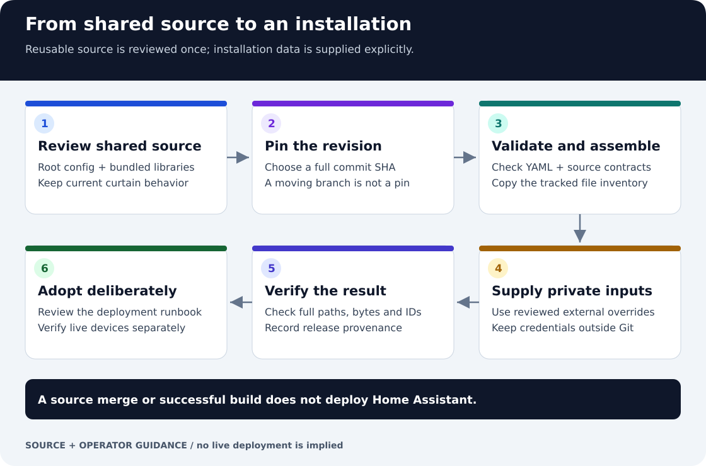

# Home Assistant · ha-homelab

[**Visual guide: process, boundaries and evidence**](docs/process-and-evidence.md)



[](docs/fuzzing.md)

## Core update approvals

The [Core updates package and dashboard](docs/core-updates.md) show stable Home
Assistant releases and offer explicit version-specific approval. The independent
k3s worker takes a verified backup, checks the target configuration and performs
the update. HACS maintenance waits while Core updating or recovery is active.
Credentials stay in private HA secrets; no token is sent to the dashboard.


Versioned configuration for the existing Home Assistant Container installation on **h7 / k3s**. The runtime CI compatibility baseline is **Home Assistant 2026.9.1**; validate the assembled overlay against the actual installation before deployment.

The [KMC and Supernight role guide](docs/outlet-role-reassignment.md) documents
the current Recliner, Living lamp, Studio TV and Studio Guard assignments,
retained Switch01–03 devices, reference migration and verification boundaries.

## Get the complete configuration

```bash
git clone https://github.com/ha-homelab/home-assistant.git
cd home-assistant
python3 -m venv .venv
. .venv/bin/activate
pip install -r requirements.txt
python tools/validate.py
python tools/build.py /private/path/ha-release --secrets /private/path/secrets.yaml
```

The automation and script libraries are bundled as ordinary directories in this
repository. No private submodules or GitHub credentials are required to clone,
validate or assemble the source. The build copies their `config/` directories to
`automations/` and `scripts/`, rejects dirty checkouts and nested repositories,
and records the root commit plus both component tree hashes in `release.json`.
See [public source and deployment boundaries](docs/public-source.md).

## Repository layout

- `config/`: active root configuration, focused integration files, helpers, templates, scenes, themes and the IGW blueprint.
- `dependencies/automations/`: 98 active automations with stable identities and a first-deployment migration map.
- `dependencies/scripts/`: 50 active scripts with stable object keys, English descriptions and documented inputs.
- `tools/`: strict YAML validation, reproducible assembly and validation inside the installed container.
- `docs/`: deployment, rollback, architecture and validation evidence.
- `archive/`: previously shadowed configuration, kept outside HA include paths.
- `secrets.yaml.example`: names of required local secrets, with placeholders only.

## Configuration contract

Deployment hostnames are supplied through local `secrets.yaml` entries:
`home_assistant_external_url`, `ott_control_devices_url`, and
`ott_control_d1_input_url`. Populate them with the existing working URLs before
deploying; placeholder examples are in `secrets.yaml.example`. Camera MAC and
location inventories stay in the private h3 configuration and HA registries.

[Lovelace input contrast](docs/lovelace-input-contrast.md) explains the dark theme's
base palette, the white-on-white form regression, and browser verification.

[RF Airbridge](docs/rf-airbridge.md) adds an exact-code MQTT counter example and
an explicit, validated RF transmit script while retaining the existing motion
sensor automations. Its counter is a storage-backed helper; create or restore
that helper before loading the package.

[Studio Zigbee curtains](docs/studio-curtains-zha.md) document the local ZHA
adapter, verified Zigbee pairing and installed travel calibration, motor/remote
button commands, and the remaining power-loss and Office Curtains migration checks.

[Living-room RF curtains](docs/living-curtains-rf.md) start main and sheer motor
commands three seconds after socket power, while retaining independent Wi-Fi
fallbacks and the existing schedules, manual override, and other-room behavior.

[Victron Off-grid mode](docs/victron-black-start.md) persists the operator mode,
blocks economic and midnight shutdowns during island operation, and retains the
50 V / five-minute low-battery exception. Winter shuts down at 00:01 outside
Off-grid mode; unavailable battery data never becomes a synthetic zero. The
inverter card also explains the current overnight policy and retains the last
midnight decision through HA restarts.

Motion-controlled lighting uses a shared [timeout recovery blueprint](docs/motion-light-recovery.md).
It retries expired shutdowns when lights return, isolates device failures, and
rechecks current motion and manual overrides before each command.

[Living room presence](docs/living-room-presence.md) keeps Living lamp on during
the overnight curtain schedule and for 20 minutes after confirmed absence.

The [water pump rules](docs/water-pump-levels.md) use 26/27 cm operating thresholds
with a 1 cm gap and retain the existing pump protections.

The [automation and script audit](docs/runtime-resilience.md) documents shared optional
notification handling, MQTT escaping/queues, confirmed entity fixes and remaining
device dependencies.

[Cooktop notifications](docs/cooktop-notifications.md) use the official SmartThings
aggregate cooktop state to notify Chrome and Vitaly iPhone Air, with the household
mute and a short duplicate-suppression interval.

[Email configuration](docs/mail.md) describes the existing Gmail/parcel sensors
and the Brevo SMTP notification entity, whose credentials remain outside Git.

[Retired entities](docs/retired-entities.md) documents the removal of obsolete
motion, cloud Tuya, media, Kodi and retired LocalTuya TV dependencies.

[LocalTuya cover hotfix](docs/localtuya-cover-hotfix.md) documents recovery from
command-only motor responses without substituting a target for measured position.
The [LocalTuya recovery kit](patches/localtuya/README.md) preserves the exact upstream
diff, explains each change, and describes testing and porting it after HACS updates.
The [curtain commissioning log](docs/curtain-live-verification-2026-09-24.md)
records physical percentage checks, the two rear-motor inversion corrections,
the settings needed to rebuild LocalTuya, and the remaining power-cycle limitation.

The optional [EPG voice package](docs/epg-voice.md) provides a dynamic catalogue
of currently airing programmes and fixed programme/news shortcuts for a
configured Cast display. It rechecks each selected title and channel before
obtaining a fresh playback session from a private gateway. Google account
linking is a separate setup step; installing the package alone does not enable
Google microphone commands.

[Homeway voice](docs/homeway-voice.md) documents the verified Sage Russian
assistant, private audio URL, and the Echo Dot / LineageOS Echo Show 5
commissioning and recovery steps, including wake-word language limitations.

[Echo Plex music](docs/echo-plex-music.md) defines the default music voice
commands and the Music Assistant player, with audio served inside the home LAN.

Home Assistant loads automation lists with `!include_dir_merge_list` and scripts with `!include_dir_merge_named`. The folder libraries are edited in Git. Their stable IDs keep the UI names and dashboard references independent of file names. The existing `automations.yaml` and `scripts.yaml` files are not loaded; do not edit them expecting a runtime change.

Only active configuration is imported. The duplicate `input_number` key previously shadowed an entire helper file; the effective `nightime` helper is preserved and the inactive file is archived. Duplicate theme properties retain their effective final values. Recorder keeps its existing database and 28-day retention; the connection string is now a local secret and the ignored `purge_interval` setting is removed.

## Weekly backups and maintenance

The Sunday schedule uses **America/Los_Angeles**, including daylight-saving time:

- **03:30 — native HA backup:** export the external Oracle MySQL recorder, then
  include that verified export in the native HA archive uploaded to Synology.
  Retain **three native archives**. The k3s CronJob owns this schedule; HA's
  separate automatic timer is disabled to prevent a duplicate scheduled upload.
- **03:45 — local Music Assistant backup:** snapshot its settings and SQLite
  databases on the home worker to Synology. Retain **two successful snapshots**;
  do not include Plex music files. This transfer stays inside the home LAN.
- **04:15 — stack recovery set:** copy HA and companion-service data, k3s state,
  Kubernetes resources and required host/network configuration to Synology NFS.
  Retain **14 completed recovery sets**. This is another NAS transfer, but it
  excludes `recorder_backup/**` and native backup archives, so it does not copy
  the SQL export again. Include the latest local Music Assistant snapshots.
- **06:00 — HACS maintenance:** reuse a successful automatic backup from the
  preceding four hours before installing updates. Create another native backup
  only when updates are pending and no sufficiently recent success is available.
  With no updates or pending restart, do nothing.

The deployment operator maintains the native backup and recorder restore
instructions, full-stack recovery runbook and installation verification records.
Obtain those installation-specific procedures before operating recovery jobs.
All three scheduled backup jobs run weekly. Manual backups and the HACS fallback
can add uploads; each Oracle-to-Synology transfer consumes outbound traffic.

## Automatic HACS maintenance

Installed HACS repositories are maintained on Sundays at **06:00 Home Assistant
local time**, configured here as **America/Los_Angeles**. When updates are
available, the automation reuses a successful automatic backup from the preceding
four hours (or creates and verifies one), installs the updates
sequentially, and requests **one Home Assistant restart at the end if needed**.
This removes the need to install each repository update and restart HA manually.
The weekly maintenance window groups updates and limits interruptions to household
automations by loading updated integrations with a single restart.

The package manages the `update.*` entities supplied by HACS, including custom
integrations, dashboard resources, themes, and HACS itself. It follows the update
availability reported by HACS. It does not upgrade Home Assistant Core, the k3s
container image, Supervisor, or device firmware. Those have separate owners and
deployment procedures.

### Where the implementation lives and runs

- **Source:** [config/packages/hacs_maintenance.yaml](config/packages/hacs_maintenance.yaml)
  contains the two automations, two worker scripts, and two status helpers as one
  package. Keeping these dependent parts together makes the maintenance policy
  deployable and reviewable without changing the imported automation libraries.
- **Loading:** [config/configuration.yaml](config/configuration.yaml) includes the
  package through `homeassistant.packages: !include_dir_named packages`.
- **Runtime:** the package is deployed to `/config/packages/hacs_maintenance.yaml`
  in the existing Home Assistant Container, pod `home-assistant-0` in namespace
  `homeassistant`, on node `h7` in Kubernetes context `k3s-heaven`. Home Assistant
  runs the schedule and workers itself; no external cron job is needed.
- **Installed repositories and state:** HACS manages its downloaded files and
  runtime state on the existing `/config` volume. Integration code, `.storage`,
  credentials, and backup archives stay outside Git. This repository versions the
  maintenance policy rather than copies of downloaded HACS projects.
- **Backups:** the worker calls `backup.create_automatic`, which uses the backup
  destinations and retention configured in HA. At the documented deployment,
  this was Synology DSM with **three retained copies and no retained local copy**.
  The package does not hardcode a NAS destination or change the existing backup
  schedule. Additional backups before updates use that same retention policy.
  HACS does not export MySQL: a fallback archive includes the latest completed
  recorder export already staged in `/config/recorder_backup`, whose manifest
  records its age. A recent native archive does not by itself prove a recent
  SQL export.

### What happens during a scheduled run

1. **Select the batch.** Capture HACS update entities whose state is `on`.
   Process ordinary repositories in entity-ID order and `update.hacs_update`
   last, after other repository operations finish using the current updater.
   If there are no updates and no pending restart request, do nothing:
   no backup, installation, or restart. A run that only retries a pending restart
   also skips creating another backup.
2. **Check readiness.** Refuse to start while a HACS update or maintenance worker
   is running, while the backup manager is busy, or while required workers,
   helpers, or backup-manager state are unavailable. The coordinator uses
   `mode: single` to prevent overlapping batches.
3. **Reuse or create a confirmed backup.** Reuse an automatic backup whose
   successful completion timestamp is within the preceding **four hours**.
   Invalid, future or older timestamps require a new backup. In that case, allow
   up to **30 minutes** for the backup worker to finish, the backup manager to
   become idle, and `sensor.backup_last_successful_automatic_backup` to show a new
   success from this attempt. Updates require either a confirmed recent backup
   or successful completion of this new backup.
4. **Install one repository at a time.** Capture its target version, start the
   installation worker, and allow up to **15 minutes**. Continue only after the
   worker reports success, `in_progress` is false, and `installed_version`
   matches the captured target. A repository that is no longer ready or becomes
   unavailable before installation stops the batch.
5. **Record whether a restart is needed.** Integration and HACS installations
   set a persistent restart request. Existing HACS restart-required notices are
   also respected. Updating dashboard resources or themes alone does not request
   an HA restart.
6. **Wait for a suitable restart window.** If a restart is needed, after every
   selected update passes verification, wait up to **30 minutes** for other
   running automation and script actions, update operations, and backups to finish.
   Then call `homeassistant.restart` once. If HA stays busy, keep the restart
   request for the next scheduled run.
7. **Report and recover.** Record results in persistent HA notifications. The
   startup automation clears a saved restart request after HA starts. If a
   requested restart has not completed within two minutes, report the failure
   and retain the request.

### Why these checks are necessary

A successful backup service return alone does not prove that a remote upload
succeeded. The fresh successful-backup timestamp is the confirmation used before
any HACS files are changed. Remote-only backup retention still needs temporary
space under `/config/tmp_backups` while HA builds the archive.

An update entity can expose the new installed version before a post-install hook
fails. The worker therefore sets a separate success acknowledgment only after its
actions complete. Version values are kept as strings inside a mapping so HA's
native template rendering cannot convert a version such as `2.00` into a number.
The installer uses HACS's normal latest-version action; if a different release
appears during installation, verification stops the batch rather than accepting
a different version silently.

Backup and installation work run in separate scripts. A coordinator timeout stops
the remaining batch but **does not cancel an active worker**, which could be
writing an archive or replacing integration files. The installation worker also
saves the restart request itself, so a successful installation that finishes
after the coordinator timed out still records the need to restart.

Failures stop remaining updates and the restart for that run, and create a
notification. Updates already installed are **not automatically rolled back**.
The idle check observes currently executing actions, not pending trigger timers
or future events; an HA restart still clears pending in-memory timers. HACS keeps
its own update-discovery schedule, and unavailable entities without a known
available update are not selected.

### Where to operate and inspect it

- **Schedule and pause:** in **Settings > Automations & scenes**, open
  **HACS maintenance: update repositories and restart once**
  (`automation.hacs_maintenance_update_repositories_and_restart_once`). Disable
  this coordinator to pause future runs. To change the schedule permanently,
  edit its time trigger and description in the package YAML, then deploy the
  reviewed configuration through the workflow below.
- **Progress and failures:** open the coordinator's **Traces**; five traces are
  retained. HA **Notifications** contains the batch result and restart status,
  using notification IDs `hacs_maintenance_result` and
  `hacs_maintenance_restart`.
- **Repository versions:** use the **HACS** dashboard and the repositories'
  update entities to inspect available and installed versions.
- **Backup destination and results:** use **Settings > System > Backups**.
  The coordinator reads `sensor.backup_backup_manager_state` and
  `sensor.backup_last_successful_automatic_backup`.
- **Worker activity:** inspect `script.hacs_maintenance_backup` and
  `script.hacs_maintenance_install`. Let an active worker finish before reloading
  configuration or rolling back the maintenance policy.
- **Internal status:** `input_boolean.hacs_maintenance_restart_pending` remembers
  an outstanding restart; `input_boolean.hacs_maintenance_install_succeeded`
  acknowledges the current installation attempt. The scripts manage these
  helpers automatically; they are not user approval switches.

To request a run manually while preserving the coordinator's initial condition,
use this action in Home Assistant. It can perform real updates and a restart
when work is pending:

```yaml
action: automation.trigger
target:
  entity_id: automation.hacs_maintenance_update_repositories_and_restart_once
data:
  skip_condition: false
```

### How maintenance changes are validated and deployed

The [CI workflow](.github/workflows/ci.yml) checks YAML, include resolution,
credentials, and repository tooling. Its separate `maintenance-runtime` job runs
the [maintenance scenarios](tests/test_hacs_maintenance.py) in the deployed HA
image pinned by digest, with networking disabled and a read-only source mount.
These tests execute HA's actual script engine with isolated state and mocked
services, covering failed backups, installation failures, timeouts, version
changes, delayed completion, and restart deferral. Root verifier tests use
self-contained fixtures, so CI does not need private repository access.

For production, build and stage a clean committed checkout, run the installed HA
configuration checker, and promote with `--scope overlay`. Reload
`input_boolean`, `script`, and `automation` in that order, with a **fresh state
export and a passing idle check before each reload**. Verify existing identities,
enabled states, new package entities, and deployed file hashes afterward. The
package can be loaded without restarting HA or immediately installing updates.
Opening or updating a pull request, or pushing to `main`, runs CI; applying
configuration to HA is a separate deployment step.

The [maintenance runbook](docs/hacs-maintenance.md) describes operation and
rollback. The [September 15 deployment evidence](docs/releases/2026-09-15-hacs-maintenance.md)
records successful configuration and identity checks plus a live no-update run.
No real repository download, new production backup, or HA restart was performed
during that activation. Those outcomes are checked when a scheduled batch runs;
isolated tests do not establish live provider or device success.

## Deploy carefully and verify

Follow [deployment and rollback](docs/deployment.md). The first automation ID migration has two stages. Do not bypass it by deploying the final English aliases directly to an unregistered installation.

GitHub CI checks YAML, includes, credentials and tooling. Each component has its own behavior-preservation checks. A production release additionally requires the installed HA configuration checker, fresh state exports and runtime identity verification. A green CI run alone does not prove that a physical device or notification destination works.

The [initial release evidence](docs/releases/2026-09-15.md) records the successful h7 migration, exact deployed commits, recovery copies and remaining device/provider boundaries. The [runtime dependency inventory](docs/runtime-dependencies.json) and [BatteryLife MQTT diagnosis](docs/mqtt-number-diagnosis.md) document inherited issues for follow-up.
The [September 29 runtime classification](docs/missing-reference-runtime.md) explains the 21 still-unidentified entity references and which dormant functions need an owner decision; no substitute hardware identity is assumed.
The [self-consumption device action repair](docs/self-consumption-device-actions.md) keeps the existing load-selection rules while fixing light shutdown payloads and independent device failure handling.


## Ownership and secrets

[Architecture](docs/architecture.md) describes the boundary between this repository, k3s deployment manifests, runtime integration storage and household devices. Existing `.storage`, HACS components, databases, media, tokens and device pairing data remain local. This repository is a configuration overlay, not a replacement for the complete `/config` backup.

The repositories and organization settings are managed by [4alvit/terraform-github-ha-homelab](https://github.com/4alvit/terraform-github-ha-homelab) through Terraform Cloud. Production changes are reviewed and deployed separately from Terraform infrastructure changes.

## MPPT fan

The [MPPT fan migration](docs/mppt-fan.md) preserves the existing solar
automations, renames the ESPHome relay, and removes the former lamp from Kodi
audio shortcuts.

## Garage and kitchen outlet references

[Garage power outlets](docs/garage-power-outlets.md) documents the new door-power
and floodlight consumers while retaining both original entities and integrations.
It also resolves the floodlight identity left open in the historical September
audit. [Kitchen ESPHome outlets](docs/kitchen-esphome-outlets.md) records the
counter and tea-table IDs, preserved motion guards, and mixed-domain shutdown.

The [Bedroom Lamp rules](docs/bedroom-matter-lamp.md) restore bedroom motion for
the relocated Matter lamp and include it in both global shutdown controls,
without changing the separate Living lamp or dining-room loads.

## RC fuzz qualification

The published [v0.1.0-rc.1 release](https://github.com/ha-homelab/home-assistant/releases/tag/v0.1.0-rc.1)
contains the qualification report for that tag's exact source commit.

[Bounded Linux fuzzing](docs/fuzzing.md) qualifies release candidates with synthetic
inputs and a source-bound report. The guide documents targets, local replay and
acceptance limits. The badge identifies RC-only capability; beta publication and
hardware acceptance remain separate.

## Portable library releases

The beta/RC assets contain only the [notification frame-cache library](docs/notification-frame-cache.md),
not this household configuration. See [packaging and acceptance](docs/release-packaging.md)
for the explicit source-and-license inventory, version plans and installation tests.

## License

Original project code and documentation are available under the [MIT license](LICENSE). [Third-party notices](THIRD_PARTY_NOTICES.md) preserve separate terms for included or referenced upstream material. This grant does not relicense firmware, models, recordings, datasets or other third-party artifacts.


## Project maintenance

[Contribution guide](CONTRIBUTING.md) · [Security policy](SECURITY.md) ·
[Governance](GOVERNANCE.md) · [Code of Conduct](CODE_OF_CONDUCT.md) ·
[Roadmap](ROADMAP.md) · [Quality evidence and limits](docs/quality.md)
