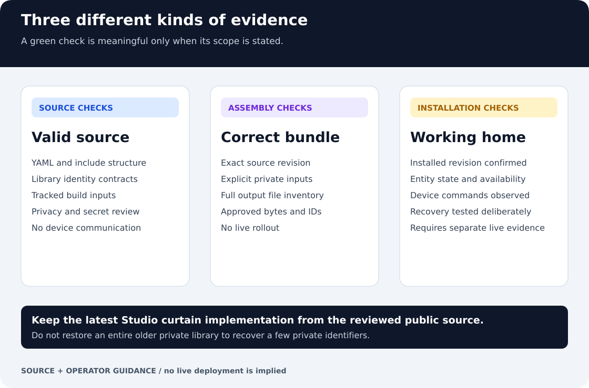

# Shared configuration: process and evidence

This guide connects the reusable configuration, installation inputs and checks
that establish a trustworthy result. It describes source behavior, not the
current state of a running Home Assistant installation.

## Ownership and inputs

This repository owns the root configuration and the bundled automation and
script libraries. The libraries are ordinary tracked directories under
dependencies/, so a public checkout does not require a private Git submodule.

Installation URLs, device bindings, notification destinations and credentials
must be supplied through the documented private-input mechanisms. A placeholder
is an example, not a working device. Existing installations should keep their
working source pin until the matching private inputs have been reviewed.

Use the [public-source contract](public-source.md) for assembly details and the
[deployment runbook](deployment.md) for installation checks. The separate
[configuration assembler](https://github.com/ha-homelab/home-assistant-private)
supports reviewed external overrides and optional identity restoration. Access
to that repository may be restricted.

## Process

1. Review the exact public commit and its configuration changes. Keep the current
   [Studio Zigbee curtain behavior](studio-curtains-zha.md), schedules and explicit
   fallbacks. Recovering private identifiers is not a reason to copy an older
   private library over the current source.
2. Validate YAML, includes and the automation/script contracts. A clean source
   build records the root revision and component tree hashes in release.json.
3. Assemble into a new output directory. For an existing installation, select
   its reviewed external overrides and credentials explicitly. When identity
   restoration is needed, its separately approved profile must match this source.
4. Compare the complete output inventory with the approved expectation, including
   definitions and references across folders and packages.
5. Review deployment separately. After adoption, verify actual entities, device
   commands and relevant recovery behavior.

The source-only checks below neither contact devices nor install configuration:

~~~sh
python tools/validate.py
python dependencies/automations/tools/validate.py
python dependencies/scripts/tools/validate.py
~~~

Use the documented environment and dependencies before running them. Building
requires a clean committed source; use the assembly command in the main README
only after selecting the appropriate public or private installation path.

## What the result proves

A successful source check establishes the tested configuration contract. A
successful assembly establishes the selected source and output bytes. Neither
proves that a sensor is online, a curtain moved or an upgrade succeeded.

The notification-example change in
[PR #18](https://github.com/ha-homelab/home-assistant/pull/18) records an offline
private restoration of 223 configuration files and a 189-state synthetic
verification fixture. Those numbers describe that recorded baseline; they are
not a current device count or live HA export. Future source revisions need their
own qualification.

## Troubleshooting

- **An example endpoint cannot work:** review the installation overrides; do not
  replace public examples with real addresses in a source commit.
- **An entity appears renamed or missing:** compare stable IDs, references and
  the private identity profile before reloading. Do not repair this by deleting
  entity-registry records.
- **A source update would revert curtain behavior:** preserve the current public
  implementation and make only the bounded, reviewed private-data restoration.
- **Source checks pass but a device is unavailable:** investigate runtime
  connectivity separately. Source validation cannot establish radio or network
  availability.
- **Sensitive data was removed from a file:** current-tree cleanup does not erase
  old commits, PR refs, logs, artifacts or clones. Review those independently.

The diagrams are local, editable SVG with embedded text and no external assets.
They are workflow illustrations, not live telemetry.
