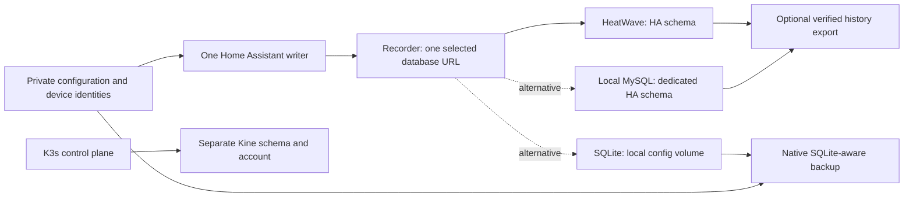

# Recorder: HeatWave, local storage, and switching back

This runbook describes a **planned database switch**, not an automatic failover.
The installation currently records to Oracle Cloud MySQL HeatWave. A local
database is an option; publishing this document does not move history or change
the running Home Assistant instance. Deployment-specific commands and volume
identities belong in the private deployment repository.

For this household, history is expendable but configuration, credentials, device
identities and automation definitions are not. If independence from the database
network is the goal, the simplest option is **a new local SQLite database** while
retaining the existing configuration. Home Assistant recommends SQLite and does
not support migrating Recorder history between database engines. Changing the
connection is supported; converting a MySQL dump into SQLite history is a
different, unsupported project. [Official Recorder guidance](https://www.home-assistant.io/integrations/recorder/#supported-databases).

## What belongs where



Only one of the three Recorder destinations is active. There is no replication,
dual write, or history merge implied by these arrows. K3s can share the managed
MySQL instance while retaining a separate schema and account; changing Recorder
must not alter the K3s datastore or its backup jobs.

- **HeatWave:** keeps database files off the HA node, but Recorder needs its
  network route and the managed database. It has its own maintenance and storage
  costs. Removing Recorder from it does not make the instance disposable if K3s
  still uses it.
- **Local SQLite:** needs no separate server and avoids that network dependency.
  Its database, WAL, checkpoints and any recovery copy consume the HA node's
  disk. Loss of that disk also loses unprotected local history.
- **Local MySQL:** retains a client/server database and supports a separately
  qualified MySQL-to-MySQL restore. It adds a database service, storage,
  credentials and maintenance. A service on another household node still has a
  network dependency; a server on the HA node shares its failure domain.

## Configuration and the existing storage policy

The public configuration includes
[`config/integrations/recorder.yaml`](../config/integrations/recorder.yaml). Its
connection is `db_url: !secret recorder_db_url`. Keep the real URL only in the
private configuration's `secrets.yaml`; `!secret` separates a value from source,
it does not encrypt it. Preserve the existing include/exclude rules when changing
the destination. [Secret handling](https://www.home-assistant.io/docs/configuration/secrets/).

The existing policy keeps one day of raw detail, enables automatic purge and
leaves automatic repacking disabled. Hourly long-term statistics survive normal
retention, **but do not follow a fresh database switch**. Energy and history views
will therefore start from the new database's contents. The retired seven-day
selective purge must not be reintroduced as a second overlapping policy.

The [storage budget](recorder-storage-budget.md) is an operating target, not a
database quota: 5 GB decimal overall, early cleanup at 3.5 GB and deployed MySQL
backpressure at 4.5 GB. The updater's guard is MySQL-specific. It must be disabled
and its pending/pause state reconciled before SQLite is selected; it cannot be
relabelled as a SQLite monitor. Disabling Recorder alone is not a database write
fence, because statistics and already queued work can still write.

## Prepare a change window

1. Keep the current Core image unchanged. Record the active database engine,
   private configuration location, owner of the HA workload, volume location,
   and available disk space. Do not combine an engine switch with a Core upgrade.
2. Verify a usable configuration/device backup and its age. The accepted Core
   update policy is `backup_mode: scheduled`: it does **not** create or verify a
   fresh archive for every update. This runbook does not reinstate mandatory
   Oracle history exports. An optional history export is needed only if preserving
   that history is part of this particular change.
3. Check for an in-progress Core update, HACS maintenance, backup, purge or
   restore. Finish or resolve it first. Record and temporarily suspend the actual
   reconcilers and schedules which could restart HA or launch a MySQL export.
   Restore their recorded states afterward, not a blanket “enabled” state.
4. Inspect any existing SQLite files before choosing the destination. Never
   assume that a file left from an older installation is an empty new database.
   Keep an existing coherent database generation separately, or choose a new
   filename. The deployment runbook uses the default filename only when absent.
5. Place SQLite on a persistent **node-local filesystem**, with one HA writer.
   Do not put its live database on an NFS/SMB music or backup share. SQLite WAL
   relies on same-host shared memory and locking; network filesystem tests do
   not establish that it is safe. NAS storage remains suitable for completed
   backup archives. [SQLite WAL](https://www.sqlite.org/wal.html),
   [network filesystem limitations](https://www.sqlite.org/useovernet.html).

For planning, reserve the database and WAL budget, at least another database-sized
working allowance, existing HA data, logs, images and the node's eviction reserve.
The private runbook records the actual local-path mount. A PVC's requested size
is not proof of an enforced filesystem quota. Repack/repair may need substantial
temporary space; a nearly full node is not a suitable SQLite destination.

## HeatWave → fresh SQLite

These are ordered operator steps, not a command to run against a live instance
without a maintenance window.

1. Preserve the current private connection value in protected operator storage.
   Do not put it in a terminal transcript, issue, command argument or commit.
2. Disable the MySQL budget worker through its existing settings/installer, after
   resolving its outstanding operation. Preserve its durable receipt. Adapt the
   scheduled backup route: the current MySQL export wrapper deliberately rejects
   SQLite and cannot be left running as if it covered the new database. Qualify
   native HA backups with SQLite coverage and the intended destinations first;
   otherwise keep that incompatible job suspended and report the backup gap.
3. Stop the HA workload gracefully and verify **zero HA writers**. A UI restart
   or `recorder.disable` is not sufficient. Fence automatic restarts/reconciliation
   for the window; never force-delete a still-running pod to bypass this step.
4. In the existing private secret file, change only the Recorder value:

   ```yaml
   recorder_db_url: sqlite:////config/home-assistant_v2.db
   ```

   This absolute path contains four slashes after `sqlite:`. Keep file ownership
   and private permissions. Validate configuration with the same HA image in an
   isolated configuration-check invocation; do not start a second HA instance.
5. Restore exactly one HA instance. Confirm that Recorder initializes SQLite,
   creates the expected file, and writes fresh history. Check a normally changing
   included sensor twice across a commit interval; a healthy UI alone does not
   prove that Recorder works. Inspect Recorder errors without publishing URLs.
6. Verify the adapted backup route, disk monitoring and the original automation
   behavior. Keep the old HeatWave schema intact during the acceptance period.
   Removing that schema or cancelling its service is a separate decision.

## SQLite → HeatWave

Choose explicitly between reconnecting to the retained HA schema and starting
an empty HA schema. Verify database reachability, account grants, TLS settings
and schema compatibility with the **current** HA version before changing it.

Stop HA and fence competing writers as above. If local history is worth keeping,
make a consistent SQLite backup; otherwise acknowledge that it will not appear
after the switch. Restore the protected HeatWave URL in `recorder_db_url`, validate
configuration, and start one HA instance. A retained schema provides its old
history plus subsequent writes, with a gap for the local period. Neither SQLite
history nor statistics are automatically copied or merged into it.

Requalify the MySQL storage probe and its exact schema/account, reconcile the
preserved guard receipt, and only then re-enable the MySQL budget worker and
reviewed MySQL backup schedule. Do not clear a pause merely to force recording.
Never run an older HA binary against a schema upgraded by a newer version as an
automatic rollback; restore a compatible recovery set or use a fresh database.

## HeatWave ↔ local MySQL

Prepare a supported MySQL server on persistent storage, a dedicated HA schema,
an HA-only account, the required route/TLS configuration and its startup order.
The source companion MariaDB manifest is a historical template, not an installed
or validated replacement. The target must not be the Kine schema.

The fresh-history path uses the same stop/change/start procedure. For retained
history, use the existing verified MySQL export/import tooling against an
**isolated empty destination**, after checking server/client compatibility,
character set, collations, SQL modes, grants and available disk. Inspect both
compressed and expanded sizes. A successful decompression is not a successful
restore. Validate the imported schema with the intended HA image before the
cutover. Do not infer HeatWave-to-local downgrade compatibility from the word
“MySQL.” [MySQL dump options and limitations](https://dev.mysql.com/doc/refman/8.4/en/mysqldump.html).

A consistent online export represents its capture point. To avoid losing writes
after that point, the final export must follow fencing the old HA writer, or the
gap must be explicitly accepted. Keep the old destination unchanged until the
new one passes validation. Switching back follows the same rule: reconnecting
the old server does not import the writes made on the new server.

## SQLite backup, validation and recovery

Prefer the native HA backup route verified to include the SQLite database. For
a separate online copy, use SQLite's backup API; a plain copy of the main `.db`
while HA writes can omit committed WAL data. A cold copy requires all database
users stopped and the database/any remaining `-wal` and `-shm` files handled as
one coherent generation. Never delete a WAL to “unlock” a database.
[SQLite backup API](https://www.sqlite.org/backup.html).

Run integrity checks on the separate copy, not an unbounded scan of the active
Recorder. Restore with HA stopped, preserve the failed generation for diagnosis,
verify ownership and the target path, and start only one writer. A configuration
backup without database coverage restores settings and identities, not history.

Troubleshooting order:

- **UI works, history does not:** verify the effective backend, Recorder startup
  errors, schema grants or file permissions, and a fresh persisted timestamp.
- **Database locked / large WAL:** check duplicate processes, long readers,
  filesystem locality and free space. Do not disable locking or discard sidecars.
- **Files stay large after purge:** deleted pages may be reusable, without the
  file shrinking. Schedule a separately budgeted repack only if needed.
- **Old history reappears after switching back:** expected when reconnecting to
  the retained database; the intervening period was not merged.
- **Backup/guard fails immediately on SQLite:** the deployed MySQL adapters were
  not adapted. Keep their state and fix the route; do not conceal the failure by
  recording a successful backup or a zero-byte database measurement.

## Implementation status

Checked on November 11, 2026: [HA configuration PR #94](https://github.com/ha-homelab/home-assistant/pull/94)
and [shared runtime PR #65](https://github.com/ha-homelab/k3s-self-healing/pull/65)
are merged. They cover retention, the qualified Recorder purge fix and storage
backpressure; they do not perform an engine switch. Deployment-specific pending
PRs, private mount paths and settings are tracked in the private operator runbook.
See also [retention semantics](recorder-retention.md) and
[native Core updates](core-native-updates.md).
