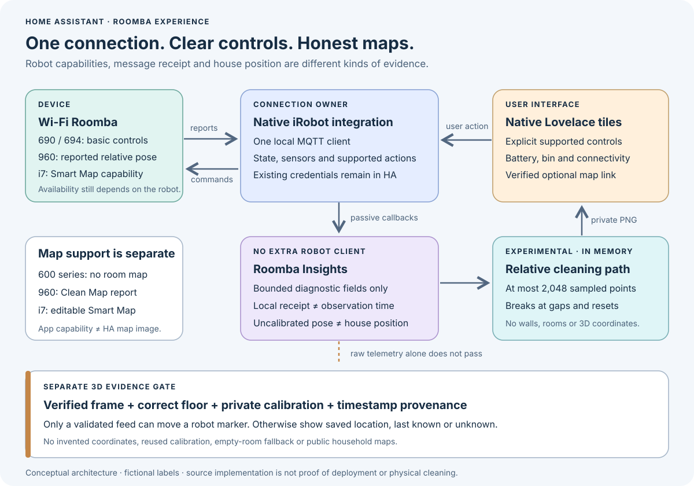

# Roomba controls, maps and local telemetry

This repository adds a native Lovelace fleet view and an optional **Roomba
Insights** companion integration. They reuse Home Assistant's existing iRobot
integration. The dashboard exposes supported controls and useful diagnostics;
the companion observes local messages without opening another robot connection.
An experimental image can draw a relative cleaning path from supported robots'
actual pose messages. It does not create a house map.

Source availability, passing tests, installation in HA, and a successful physical
cleaning test are separate results. This guide describes the implementation and
its commissioning procedure; it does not assert that a particular home has
completed deployment or mapping.



## Which robots can show maps?

- **Roomba 690 / 694:** the 600 series has no Clean Map reports or persistent
  room maps. Show cleaning state, available battery/bin sensors and supported
  controls. Do not add nonfunctional room-selection buttons. iRobot explicitly
  excludes the 600 series from [Clean Map reports](https://homesupport.irobot.com/articles/en_US/Knowledge/1145).
- **Roomba 960:** the 900 series supports Clean Map reports in the iRobot app,
  subject to its software requirements. Those reports are different from the
  editable Imprint Smart Maps used for directed room cleaning. The native HA
  integration can expose a reported pose when the robot advertises that
  capability. A pose is not a downloaded map image or a calibrated house
  location. See [iRobot's compatibility list](https://homesupport.irobot.com/articles/en_US/Knowledge/17758)
  and the [HA 2026.10.0 pose implementation](https://github.com/home-assistant/core/blob/2026.10.0/homeassistant/components/roomba/vacuum.py).
- **Roomba i7 / i7+:** supports Imprint Smart Maps and directed room cleaning in
  the iRobot ecosystem. Actual map/version IDs and room definitions must still
  be obtained and verified for the particular robot. Hardware support does not
  mean the standard HA integration exposes a map image. See
  [iRobot's mapping guide](https://homesupport.irobot.com/articles/en_US/Knowledge/64102).
- **Other models:** inspect the real model and native integration capabilities.
  Do not infer mapping support from a friendly name or the presence of a generic
  `vacuum.send_command` action. HA's [native integration documentation](https://www.home-assistant.io/integrations/roomba/)
  also lists model exclusions.

## One connection owns the robot

The robot's local MQTT server permits one client connection. The native HA
integration owns it; opening a second mapping client can disrupt normal
controls. Roomba Insights attaches callbacks to the native `roombapy` instance
and removes only its own callbacks when unloaded. It never calls connect,
disconnect, start, dock or other robot commands. See the
[HA connection warning](https://www.home-assistant.io/integrations/roomba/#configuration)
and [roombapy 1.9.1 callback implementation](https://github.com/pschmitt/roombapy/blob/1.9.1/roombapy/roomba.py).

The companion discovers native entries every 30 seconds, including entries that
are temporarily unavailable. It follows a replaced native client after an entry
reload. This is local bookkeeping, not another network polling connection.
Removing the companion leaves native robot control intact.

## Install and interpret telemetry

Follow the companion's [installation, lifecycle and telemetry
reference](roomba-insights.md) to copy the component, restart HA at a coordinated
maintenance point and add **Roomba Insights** through Devices & services. The
flow needs no credentials. Removing that companion entry detaches its observers
and preserves the native iRobot integration; remove its dashboard references
before deleting the component files.

The compatibility target is **HA 2026.10.0**, whose native integration uses
**roombapy 1.9.1**. The companion relies on native runtime data and callback
interfaces, so re-run lifecycle tests before changing either version. It adds
no third-party Python dependency of its own.

The diagnostic sensor reports native connection/mission state, bounded map
references and an optional nested `position`. Its `observed_at` stays `null`;
`received_at` means local receipt of a complete pose, and `cache_read_at` means
inspection of cached data. Neither timestamp proves when the robot occupied a
location. The position remains `uncalibrated`; `position_current` stays false.
Unrelated updates and incomplete pose messages cannot make it fresh.

A captured room request is only evidence. The companion checks that an actual
complete `start` message has nonempty valid regions and an unambiguous map
version, but does not replay it. A matching catalog does not establish the
active floor or physical room labels. Never substitute a whole-home `start`
when room selection is empty, invalid or no longer matches its map version.

## Experimental relative path, not a house map

Pose-capable robots gain a **Relative cleaning path** image. A connected robot
must report a valid mission identity, an active cleaning phase, and at least
two complete pose points before the image becomes available. Cached startup
coordinates are never drawn. A robot or firmware without the required mission
fields will correctly leave this feature unavailable.

The plain PNG shows only sampled relative motion. It cannot show walls, room
boundaries, absolute coverage, or where the robot is on the home's 3D plan.
Mission changes and reconnects start a new trace; invalid poses and temporal or
coordinate gaps break the line. The history is limited to 2,048 points and
exists only in memory. The technical [path contract](roomba-insights.md#experimental-relative-cleaning-path)
documents the sampling, image and lifecycle limits.

Bind the actual image entity to the dedicated `trail` slot in the Lovelace
profile below. It may be unavailable initially: the view shows an explanation
while waiting for a connection, mission identity or enough valid poses. Once a
supervised clean produces a real image, inspect it against the intended robot's
movement. Software and synthetic pixel tests do not establish that physical
correspondence; physical acceptance remains outstanding.

## Generate the Lovelace view

[`scripts/build_roomba_dashboard.py`](../scripts/build_roomba_dashboard.py) runs
offline. It uses an explicit list of robots and related entities, rather than
guessing relationships from names. Native tiles show only reported supported
commands. Robot movement controls are hidden for unknown/unavailable states;
entity details remain accessible. An optional **Power dock on** button only
turns a configured dock switch on, never off.

The following input is entirely fictional. Replace its IDs and state records
with a private inventory of your actual entities:

```json
{
  "states": [
    {"entity_id": "vacuum.example_robot", "state": "docked", "attributes": {"supported_features": 13084}},
    {"entity_id": "sensor.example_robot_battery", "state": "90", "attributes": {}},
    {"entity_id": "binary_sensor.example_robot_network", "state": "on", "attributes": {}},
    {"entity_id": "sensor.example_robot_local_telemetry", "state": "charge", "attributes": {}},
    {"entity_id": "image.example_robot_relative_cleaning_path", "state": "unavailable", "attributes": {}}
  ],
  "profiles": [{
    "entity": "vacuum.example_robot",
    "name": "Example robot",
    "model": "960",
    "battery": "sensor.example_robot_battery",
    "network": "binary_sensor.example_robot_network",
    "telemetry": "sensor.example_robot_local_telemetry",
    "trail": "image.example_robot_relative_cleaning_path",
    "capability_note": "Experimental relative path; no room map is configured."
  }]
}
```

```sh
python3 scripts/build_roomba_dashboard.py /private/robot-inventory.json \
  --output /private/roombas-view.json

# Optional: merge into a newly exported dashboard, without contacting HA.
python3 scripts/build_roomba_dashboard.py /private/robot-inventory.json \
  --dashboard /private/current-dashboard.json \
  --output /private/updated-dashboard.json
```

Optional profile keys include `charging`, `bin_full`, `dock_power`,
`last_recovery`, `telemetry`, `trail`, and `statistics`. The explicit telemetry binding
shows its state and `last_message_received_at`, or **Never received** when no
message has arrived. Use actual separate battery sensors when the
native vacuum no longer has a `battery_level` attribute. Every referenced entity
must exist in the input inventory. Source state attributes are not copied
wholesale into the generated configuration.

The `trail` binding requires an existing image entity but permits its waiting
or unavailable state. It is always labelled as an experimental relative path,
with a reason shown when no image can be displayed. It does not assert that a
house map has been verified.

A separately verified map may be supplied as exactly one of:

```json
{"map": {"verified": true, "entity": "image.example_robot_map"}}
```

```json
{"map": {"verified": true, "navigation_path": "/lovelace/example-map"}}
```

The image/camera entity must be present and available at generation time. A
navigation target must be local. `verified: true` is the operator's assertion
that the association was checked; the generator cannot inspect map contents or
turn a screenshot into a live map. No map is shown if none is configured.

Review the generated view before applying it. The optional merge adds/replaces
the `roombas` view and replaces only legacy `custom:vacuum-card` cards for the
selected robots with navigation tiles. It preserves other views and robots.
Those navigation tiles target `/lovelace/roombas`; adjust that path before use
in a differently named dashboard. Re-read the live dashboard immediately before
saving so another editor's changes are not overwritten. The generator itself
does not save to HA, toggle power or start cleaning.

## 3D placement requires separate evidence

A saved dock marker can show a known installation location. A moving robot
marker requires a validated map identity, native units and axes, a separately
checked transform into the correct floor, and honest timestamp provenance.
Relative odometry from a 960 must not borrow another robot's calibration.
An i7 map catalog alone does not establish a usable coordinate frame either.

The companion deliberately emits its pose under `position`, with no top-level
floorplan `x`, `y` or fabricated `map_id`. This prevents accidental admission
as a calibrated 3D feed. Keep private geometry and calibration in the private
floorplan project. Revalidate alignment after a map reset or a changed frame;
show unknown/last-known states rather than inventing motion.

## Connectivity and recovery

- **Dock power off:** restore the intended dock supply and check charging. A
  battery-powered robot can still be online while its dock has no power.
- **No Ping response:** investigate power, DHCP, Wi-Fi coverage and firewall
  policy. ICMP failure alone does not prove the robot is dead.
- **Ping succeeds, HA unavailable:** check native entry status, local MQTT
  reachability and competing clients. A working IP address does not establish
  an authenticated robot session.
- **Drops in particular rooms:** inspect access-point coverage and roaming
  before repeatedly reloading integrations. A recovery loop cannot repair a
  radio dead zone or charge an unpowered robot.
- **Pose unavailable:** check advertised capability and actual received data.
  Do not add dummy coordinates, constant timestamps or synthetic map IDs.

The separate [connection recovery package](roomba-network-recovery.md) adds
rate-limited native-entry reloads for reachable but unavailable robots. Its
current rules require 60 seconds of network reachability, 120 seconds of entity
unavailability and a 15-minute attempt cooldown. It never starts cleaning.
Adapt its private entity/address bindings to your installation; do not create a
second competing retry loop or poll the robot with another MQTT client.

## Verification and privacy

Run the focused tests from the repository root:

```sh
python3 -m unittest discover -s tests -p 'test_roomba_dashboard.py' -v
python3 -m unittest discover -s tests -p 'test_roomba_insights.py' -v
python3 -m unittest discover -s tests -p 'test_roomba_trail.py' -v
```

Pure tests cover strict inputs, supported controls, merge preservation, receipt
provenance, partial poses, malformed regions, changed map versions and sensitive
field exclusion. The insights suite also contains HA lifecycle/setup tests;
without the HA runtime these are **skipped**, not passed. Run that suite in the
target HA 2026.10.0 environment to verify singleton setup, mixed available/offline
entries, callback cleanup and native-client replacement.

On 2026-10-22, all **46 component tests passed in the HA 2026.10.0 runtime**, with
no skips: 23 insights tests and 23 trail tests, including five ImageEntity
lifecycle tests. The setup fixture used five synthetic native entries with one
loaded, pose-capable fake connection; both sensor and image platforms were
loaded and unloaded. The 15 dashboard tests also passed locally. This verifies
software compatibility, not a physical robot's connectivity, map availability,
cleaning-path accuracy or deployment of the companion. Local runs skip the
HA-specific tests when HA is not installed.

After installation, verify sensors and the dashboard in HA. Confirm a command
with an appropriate supervised physical test before claiming cleaning works.
Verify the correct map and room on the correct robot before enabling directed
cleaning. A software test cannot prove Wi-Fi coverage or physical alignment.

Keep inventories, diagnostics, map images, room definitions, coordinates,
calibrations, addresses and credentials private. Generated output is written
with private file permissions but still requires private storage. Do not place
maps under public `/local/` assets, commit them to this repository or attach
raw HA inventories to public issues. Public examples must remain fictional.
