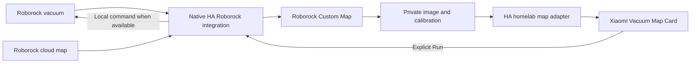

# Vacuum maps and room cleaning

The **Vacuum maps** Lovelace view adds an interactive Roborock map while keeping
the existing vacuum controls on the Home view. Select a room, draw a rectangular
zone, or choose a destination, then press **Run**. Selecting the map alone does
not start the robot. Pause, stop, return to dock, cleaning settings, dock settings,
and maintenance status are available alongside the map.

## Data and command paths



Maps still depend on the Roborock cloud. This setup does not make map retrieval
offline. Roborock Custom Map reuses the native integration's coordinators and
map data; it does not need another account login or a second cloud poller.

The public repository contains the generator and synthetic tests, not a house
plan. Image tokens, map images, calibration coordinates, private entity exports,
and the generated deployment view belong in private storage. Optional `room_names`
aliases are also private: they connect robot segments to the actual floorplan. Do not attach live
map screenshots to public issues or pull requests.

## Tested components

- Home Assistant Core 2026.10.0, native `roborock` integration.
- [Roborock Custom Map 0.1.6](https://github.com/Python-roborock/RoborockCustomMap/tree/0.1.6).
- [Xiaomi Vacuum Map Card 2.4.1](https://github.com/PiotrMachowski/lovelace-xiaomi-vacuum-map-card/tree/v2.4.1).
- The small local adapter in `config/www/roborock-map-card.js`.

Use a released custom-map version, not an unreleased default branch. Install it
through HACS and add **Roborock Custom Map** once under Devices & services. The
entry reuses the loaded native Roborock entry and creates an image ending in
`_custom`. On the tested HACS first installation the component cache refreshed
and the entry loaded without restarting Core. Follow a restart prompt on other
versions; coordinate it with any active voice or device tests.

Register Xiaomi Vacuum Map Card once through HACS. Copy the local adapter to
`/config/www/roborock-map-card.js` and add `/local/roborock-map-card.js` as a
JavaScript module resource in Lovelace. An already registered resource must not
be added a second time. Use a changed version query string and refresh the
browser after updating the local adapter.

## Generate the private view

`scripts/build_vacuum_dashboard.py` is a pure local generator. It does not log in
to HA, install integrations, save a dashboard, or call a vacuum. Supply an explicit
allowlist of entities rather than a whole-house dashboard export:

```sh
umask 077
python scripts/build_vacuum_dashboard.py /private/vacuum-input.json \
  --output /private/vacuum-view.json
python -m unittest discover -s tests -p test_vacuum_dashboard.py -v
```

The input contains `states`, `vacuum_entity`, `map_entity`, a `room_ids` allowlist verified against the current custom map
segments, with `roborock.get_maps` as an additional metadata check, optional `controls`
sections (`status`, `cleaning`, `dock`, `maintenance`), and optional
`other_vacuums`. Optional `room_names` maps verified segment IDs to private
floorplan labels. Only explicitly supplied aliases are copied into the output;
the live device labels are otherwise read dynamically. Use live custom-image
attributes, not a copied screenshot or
guessed calibration. The generator rejects unavailable or invalid initial map
data. See the synthetic fixtures in the tests for the input structure.

Merge the resulting view by its `path: vacuum-map` into the **latest** dashboard
configuration. Preserve every unrelated view and card. Add a navigation action
from the existing Roborock card to `/lovelace/vacuum-map`; do not remove the Home
view's normal controls. Read the saved configuration back and compare it with
the intended patch. Reapplying the view must replace that path, not append a
duplicate tab.

To roll back the UI, remove the generated view and its navigation button from
the latest dashboard configuration. Unregister the local adapter resource only
after checking that no other view references it. Existing native vacuum controls
and integrations are independent of this view.

The local adapter reads room geometry from the current custom image rather
than freezing the initial house coordinates into the YAML. It forwards every HA
state update to the map card while rebuilding its configuration only when the
map metadata changes. This preserves selections during ordinary status updates
and avoids a false disconnection warning after six minutes of idle time. If calibration or
room data becomes unavailable, the interactive card is replaced by a message.
It must not keep sending commands from an old map. Only verified room IDs are
offered. Map-parser room IDs come from the robot’s binary map; missing friendly
names do not make those segments invalid. The generated configuration keeps
them explicit so a map replacement cannot silently introduce new targets. After changing or remapping
floors, verify the selected image, available room IDs, and labels again before
starting a room clean.


## Matching the architectural floorplan

Match the current robot map to the private architectural plan using orientation,
room adjacency, bathrooms, hallways and external walls. Check the plan's display
name overrides: an internal room key need not match the name shown in HA. Keep
the correspondence and any affine transform private.

A robot segment is not necessarily one architectural room. If a segment spans
several rooms, its label must state the combined scope; a small detached fragment
should say which room it belongs to. Renaming a segment in this view does not split
it or change the vendor map. Use a drawn cleaning zone for only part of a segment,
or edit the segmentation in the vendor application and review the IDs again.

Aliases change only the HA view. They do not rename vendor-cloud rooms or issue
commands. Keep label keys inside the reviewed `room_ids` allowlist. Missing map
segments disable the old interactive configuration until it is reviewed.

## Read-only positions for a private 3D plan

`config/packages/vacuum_floorplan_position.yaml` exposes
`sensor.roborock_q_revo_floorplan_position`. It calls the existing native
`roborock.get_vacuum_current_position` action; it never starts, moves or docks
a robot. Adjust the explicitly named source vacuum and selected-map entity if
using this package for another installation.

The feed polls every 15 seconds while cleaning or returning and once a minute
otherwise, with an immediate refresh on source state changes. It resolves a
unique map ID from the native cached map catalog before and after reading the
position. A changed selector, changed catalog association, failed request,
missing source or invalid coordinate makes the sensor unavailable. The last
valid coordinates and their original map association remain as last-known data
within the running HA session. HA does not restore a saved `unavailable` state
after a restart, so an offline start may have no coordinates until a successful
read. The viewer must allow missing attributes and must not invent a position.

The successful state is `reported`. Its attributes are:

- `x`, `y`: reported coordinates in the Roborock map coordinate system, in mm.
- `map_id`, `selected_map`: the checked map association, not a guessed default.
- `retrieved_at`: UTC time when HA obtained a valid result.
- `observed_at: null`, `timestamp_quality: not_provided`: the native action
  does not supply the time of the robot's observation.
- `source`, `source_entity`, `map_id_source`, `coordinate_system`, `units`:
  provenance needed by the plan viewer.

A successful request can return an unchanged cached pose. **A recent
`retrieved_at` is not evidence that the robot measured its position recently.**
The viewer should say “reported position” and show retrieval age, mark a
stale/disconnected source as last known, and refuse to project onto a different
map ID. A private transform calibrated against the real plan is required;
approximate alignment must be labelled as such. Never interpolate a fabricated
live path from a docked or unavailable source.

Keep the transform, coordinates, private room aliases, screenshots and calibration
fixtures out of the public repository. The public tests use synthetic values.
The package can be loaded with a targeted `template.reload` after validating the
assembled configuration; a Core restart is not required. Coordinate reloads with
other active tests, because this reload affects the template integration.
To roll back, remove this package and reload templates. Remove its viewer binding
as well, so the last-known marker is not mistaken for an active feed.

Run the behavioral tests in an isolated Home Assistant runtime:

```sh
REQUIRE_HA_RUNTIME=1 python -m unittest discover -s tests \
  -p test_vacuum_floorplan_position.py -v
```

They simulate malformed responses, failed services, unavailable devices and map
changes; they do not contact a real vacuum. CI runs this test in its pinned HA
container with networking disabled.

## Model limits

The native HA Roomba integration exposes vacuum controls and sensors, but no map
image or room inventory. Do not present a generic map card as proof of support:

- **Roomba 690 / 694:** no map or room selection capability.
- **Roomba 960:** a cleaning report and position/path information are not a
  persistent Smart Map. It cannot perform directed room cleaning.
- **Roomba Vac Essential Q011020:** a cleaning report is available in the iRobot
  application, but not through the installed HA integration. No Smart Map room
  selection.
- **Roomba i7 / i7+:** the device supports Smart Maps and rooms. Local room
  commands require actual `pmap_id`, `user_pmapv_id`, and `regions` from that
  robot's map. The native HA integration does not discover them. Never invent
  IDs or send empty `regions` as a test: that can start a whole-house clean.

Do not add a second persistent `rest980` connection alongside HA to obtain a
map. Roomba normally permits only one local MQTT connection. A powered-off or
unavailable robot also cannot validate a new room command.

## Verification and troubleshooting

The implementation has 12 generator/adapter tests (including a Node lifecycle
suite) and 13 position tests executed in an isolated HA 2026.10.1 runtime, with
the service semantics checked against the installed HA 2026.10.0 source. The
position suite covers zero coordinates, malformed and non-finite values,
map-switch races, failed reads, overlapping polls and restored successful state.
UI verification covers all eight available segments, room/zone/point selection
without dispatching a movement command, and an idempotent dashboard save.
Physical room-cleaning accuracy is a separate, unperformed acceptance test.

1. Confirm the native vacuum is available and its ordinary image is current.
2. Confirm the custom image has nonempty `calibration_points` and `rooms`.
3. Inspect the custom image’s `rooms` and compare the native `roborock.get_maps`
   response. They use different metadata sources: `get_maps` can omit segments
   without a name-mapping record. The image parser extracts actual segment IDs
   from the binary map. Use those IDs with `Room N` for unnamed rooms; never
   infer IDs from image colors or invent room numbers.
4. Open the view in a browser. Check the image, room labels, selectable rooms,
   zone drawing, point selection, and absence of card errors.
5. Verify that changing a selection does not start the robot. A service schema
   or UI rendering check does not prove physical cleaning; record those checks
   separately.
6. For a physical test, clear the intended floor area, select one known room or
   small zone, press Run, then check the robot and its reported state. Pause and
   return to dock when finished. Do not run this during an acoustic voice test.

**Image visible but selection shifted:** check that image and calibration belong
to the same custom image, map and rotation. Do not correct this by guessing
three coordinates. A plain native image has no calibration attributes.

**Custom image unavailable:** verify the native Roborock entry is loaded first,
then reload only the custom-map entry. Do not create duplicate entries or
re-pair the vacuum as the first troubleshooting step.

**Rooms absent or unexpected:** compare `roborock.get_maps` and image metadata.
Finish/rename rooms in the vendor application if necessary and refresh map data.
Room order is selected by the robot. Freehand polygons and room ordering are
not promised by this card configuration.

**Other vacuums unavailable:** check their power, network availability and native
integration. A dashboard change cannot restore a powered-off robot. Keep the
existing network-aware Roomba recovery automation rather than adding a competing
connection.

## Upstream references

- [HA Roborock integration and actions](https://www.home-assistant.io/integrations/roborock/)
- [Native Roborock map-card template](https://github.com/PiotrMachowski/lovelace-xiaomi-vacuum-map-card/blob/v2.4.1/docs/templates/Roborock.md)
- [HA Roomba integration](https://www.home-assistant.io/integrations/roomba/)
- [iRobot mapping capabilities](https://homesupport.irobot.com/articles/en_US/Knowledge/64102)
- [Local i7 room-command structure](https://github.com/koalazak/rest980#local)
